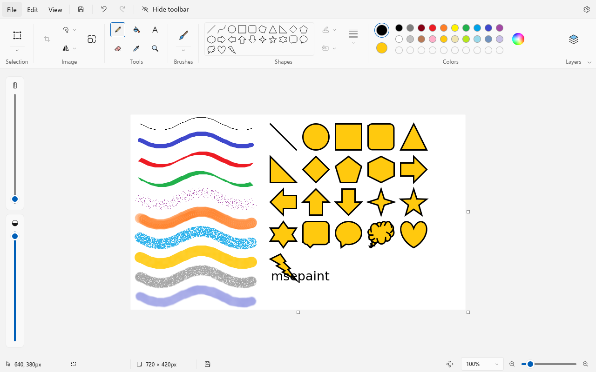

# msepaint

A simple image editor for Linux and Windows. Open a picture or start a blank canvas, draw with pencils and brushes, add shapes and
text, select and move parts of the image, crop, resize, rotate, and work with layers. One window, no accounts, no
cloud, no telemetry.



## Features

- **Drawing**: pencil, nine brushes (brush, calligraphy brush, calligraphy pen, airbrush, oil, crayon, marker, natural
  pencil, watercolor), eraser, fill bucket with tolerance, color picker and magnifier.
- **Shapes**: line, curve, polygon and 20 more (rectangles, ovals, arrows, stars, callouts, heart, lightning) with
  outline and fill styles. Shapes stay editable (move, resize, rotate) until you confirm them.
- **Text**: font, size, bold, italic, underline, strikethrough, alignment and optional background fill.
- **Selection**: rectangle or free-form, move and resize the selection, transparent selection, cut, copy, paste,
  crop, delete and invert.
- **Image**: resize and skew, rotate (90°, 180° or any angle), flip, invert colors, canvas size by dragging its edges.
- **Layers**: add, duplicate, reorder, hide, merge down, and a background color that can be changed or hidden.
- **Files**: PNG, JPEG, BMP (1/4/8/24-bit), GIF, TIFF, ICO and WEBP; HEIC/AVIF when libheif is available. Layered
  projects are saved as `.paint` files (on Linux, with libheif).
- **View**: zoom from 10 % to 1000 %, rulers, gridlines, status bar, thumbnail, light and dark themes.
- Undo and redo, printing with page setup, and "set as desktop background" (Windows, GNOME, KDE Plasma and XFCE).

## Download and run

Get the files from the [Releases](../../releases) page.

### Windows

- **Installer**: run `msepaint-<version>-windows-x64-setup.exe`. It installs for the current user (no administrator
  rights needed), adds a Start menu shortcut, an optional desktop shortcut and an "Open with" entry for images, and can
  be removed from *Settings → Apps*.
- **Portable**: unzip `msepaint-<version>-windows-x64-portable.zip` anywhere and run `msepaint.exe`.

Requires 64-bit Windows 10 or 11. The files are not code-signed, so SmartScreen may show a warning the first time:
choose *More info → Run anyway*.

### Linux

```bash
chmod +x msepaint-*-x86_64.AppImage
./msepaint-*-x86_64.AppImage
```

The AppImage targets 64-bit Linux with glibc 2.39 or newer (Ubuntu 24.04+, Debian 13+, Fedora 40+, current Arch and
derivatives) and includes Wayland and X11 support. If it does not start, your system may need FUSE 2
(`libfuse2` / `fuse2`); alternatively run it with `--appimage-extract-and-run`.

## Build from source

Requirements: CMake 3.24+, Ninja, a C++20 compiler and Qt 6.8 or newer (Base, Declarative, Svg, Image Formats).
libheif is optional.

```bash
# Ubuntu / Debian
sudo apt install build-essential cmake ninja-build qt6-base-dev qt6-declarative-dev qt6-svg-dev \
  qt6-image-formats-plugins qml6-module-qtquick qml6-module-qtquick-controls qml6-module-qtquick-layouts \
  qml6-module-qtquick-dialogs qml6-module-qtquick-shapes qml6-module-qtquick-window \
  qml6-module-qtqml-workerscript qml6-module-qtquick-templates qml6-module-qtcore libheif-dev
# Arch
sudo pacman -S base-devel cmake ninja qt6-base qt6-declarative qt6-svg qt6-imageformats libheif

cmake -S . -B build -G Ninja -DCMAKE_BUILD_TYPE=Release
cmake --build build
./build/msepaint
```

Install for the current user (adds a launcher to the applications menu):

```bash
cmake -S . -B build -G Ninja -DCMAKE_BUILD_TYPE=Release -DCMAKE_INSTALL_PREFIX="$HOME/.local"
cmake --build build && cmake --install build
```

To build the AppImage yourself: `scripts/build-appimage.sh`.

### Windows build

The Windows version is cross-compiled from Linux with [llvm-mingw](https://github.com/mstorsjo/llvm-mingw) (UCRT) and the
official Qt for Windows built with llvm-mingw, plus a Linux Qt of the same version for the build tools and NSIS for
the installer:

```bash
scripts/build-windows.sh <llvm-mingw-dir> <qt-windows-dir> <qt-linux-dir>
```

It produces the installer and the portable zip in `build/windows/`.

## Command line

```text
msepaint [file]              open a file
msepaint /p file             print a file with the default printer
msepaint /pt file printer    print a file with the given printer
```

## Keyboard shortcuts

| Keys | Action |
|---|---|
| Ctrl+N / Ctrl+O / Ctrl+S | New, open, save |
| Ctrl+Shift+S | Save as project |
| Ctrl+Z / Ctrl+Y | Undo, redo |
| Ctrl+X / Ctrl+C / Ctrl+V | Cut, copy, paste |
| Ctrl+A / Delete | Select all, delete selection |
| Ctrl+Shift+X | Crop to selection |
| Ctrl+W / Ctrl+E | Resize and skew, image properties |
| Ctrl+Shift+I | Invert colors |
| Ctrl+Page Up / Ctrl+Page Down | Zoom in, zoom out |
| Ctrl+0 / Ctrl+1 | 100 %, fit to window |
| Ctrl+R / Ctrl+G | Rulers, gridlines |
| Ctrl+Shift+N | New layer |
| S, P, B, T, E, I, Z | Select, pencil, fill, text, eraser, color picker, magnifier |

## Project layout

- `src/core/`: document, layers, history, tools and image algorithms (no UI dependencies).
- `src/ui/`: bridge between the core and the QML interface.
- `qml/`: the interface.
- `assets/`: fonts and icons.
- `tests/`: unit tests (`ctest --test-dir build`).

## License

msepaint is released under the [MIT License](LICENSE). It is provided "as is", without warranty of any kind.
Bundled fonts, icons and libraries keep their own licenses; see [THIRD_PARTY.md](THIRD_PARTY.md).
